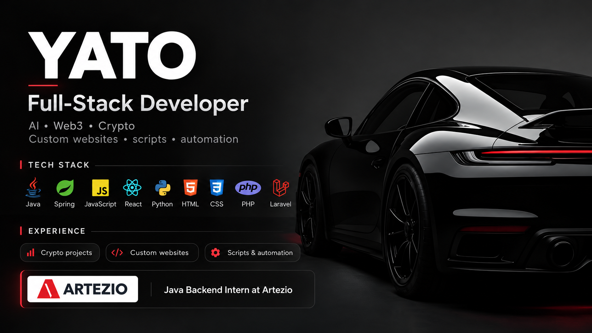

# Hi, I'm Yato.

I turn ideas into working software, from the first prototype to a functional product. I enjoy understanding how systems work end to end and finding straightforward solutions to complex problems.

## About me

- I care about practical solutions, readable code, and improving the way software is built.
- I'm interested in collaborating on technically challenging ideas.
- I like building useful tools that save time and make repetitive work easier.

**GitHub:** [@Yato828](https://github.com/Yato828)
